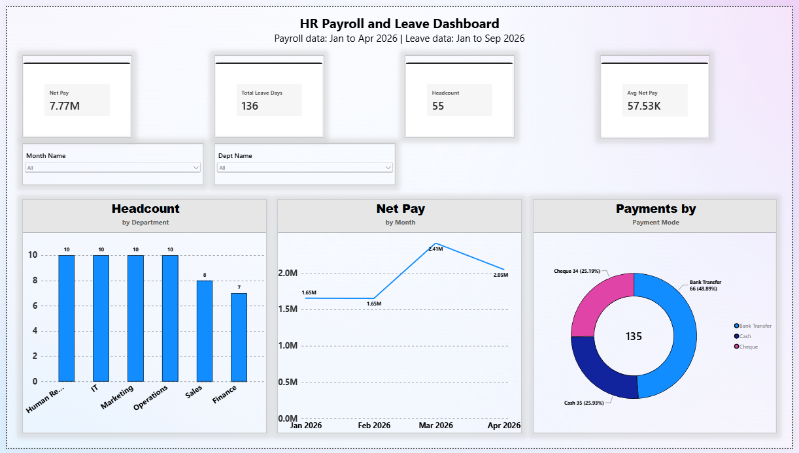
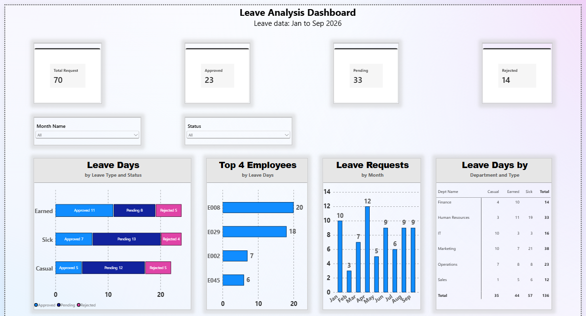
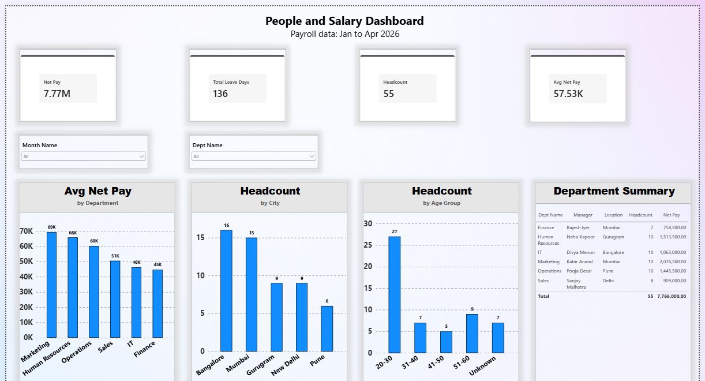

# HR Payroll and Leave Analytics Dashboard (Power BI)

An end-to-end Power BI project: raw HR CSVs, cleaned in Power Query, modeled as a star schema, and presented in a 3-page dashboard.

## Dashboard Pages

| Page | What it shows |
|---|---|
| **1. Overview** | Net Pay, Total Leave Days, Headcount, Avg Net Pay. Headcount by Department, Net Pay by Month, Payments by Payment Mode. |
| **2. Leaves** | Total / Approved / Pending / Rejected requests. Leave days by type and status, by month, by department, Top 4 employees by leave days. |
| **3. People and Salary** | Avg Net Pay by Department, Headcount by City, Headcount by Age Group, Department Summary table. |

### Page 1: Overview


### Page 2: Leaves


### Page 3: People and Salary


Full report as PDF: [DASHBOARD.pdf](DASHBOARD.pdf)

## Project Structure

```
HR_Project/
├── Project 1.pbix        Power BI report (open with Power BI Desktop)
├── DASHBOARD.pdf         3-page report exported as PDF
├── README.md
├── Data/
│   ├── Raw/              original CSV files
│   └── Cleaned/          CSV files after Power Query cleaning
└── screenshots/          dashboard page images
```

## Data

| Table | Rows | Description |
|---|---|---|
| Employees | 55 | Employee master (name, department, city, age, join date) |
| Departments | 6 | Department, manager, location, budget |
| Salary | 135 | Monthly payroll (basic, bonus, deductions, payment mode) |
| Leaves | 70 | Leave requests (type, start/end date, days, status) |

Coverage: payroll data Jan to Apr 2026, leave data Jan to Sep 2026.

## Data Cleaning (Power Query)

- Trimmed spaces, removed non-printing characters (Trim, Clean).
- Standardised text case (Capitalize Each Word).
- Standardised department names (for example HR, OPS and Information Technology mapped to Human Resources, Operations and IT).
- Removed duplicate rows.
- Found orphan keys (Emp IDs in Salary or Leaves with no matching Employee) using Merge Queries with a Left Anti join, then corrected them (E117, E119, E149).
- Replaced null Age and Status values with a visible label instead of leaving blanks.
- Verified row counts after export (last row = data rows + 1).

The raw files are in `Data/Raw/` and the cleaned files in `Data/Cleaned/`.

## Workflow

1. **Understand the data:** 4 tables (employees, departments, salary, leaves) and how they connect.
2. **Audit and clean (Power Query):** profile each column, fix text, duplicates, nulls and orphan keys.
3. **Validate:** compare row counts and key totals with the source files.
4. **Model:** star schema with a Calendar date table and relationships.
5. **Measures (DAX):** net pay, headcount, averages and leave counts.
6. **Visualise:** 3 report pages with cards, slicers and charts on a consistent grid.
7. **Check numbers:** every card and chart was matched against the CSV data.
8. **Document and publish:** README, PDF export and this repository.

## Data Model

- Star schema: **Employee** and **Department** are dimensions, **Salary** and **Leaves** are facts.
- One-to-many relationships, single filter direction.
- **Calendar** table marked as a date table, with Month Name sorted by Month Number.
- Join Date relationship is **inactive** and used through `USERELATIONSHIP`.

## Key Measures (DAX)

```
net pay = SUM(Salary[Basic Salary]) + SUM(Salary[Bonus]) - SUM(Salary[Deductions])
Headcount = DISTINCTCOUNT(Employee[Emp ID])
Avg Net Pay = DIVIDE([net pay], COUNT(Salary[Payroll ID]))
Total Leave Days = SUM(Leaves[Days])
Total Requests = COUNTROWS(Leaves)
Approved = CALCULATE(COUNTROWS(Leaves), Leaves[Status] = "Approved")
Pending  = CALCULATE(COUNTROWS(Leaves), Leaves[Status] = "Pending")
Rejected = CALCULATE(COUNTROWS(Leaves), Leaves[Status] = "Rejected")
New Joiners = CALCULATE(COUNTROWS(Employee), USERELATIONSHIP(Employee[Join Date], 'Calendar'[Date]))
```

Calculated column:

```
Age Group = SWITCH(TRUE(),
    ISBLANK(Employee[Age]), "4. Unknown",
    Employee[Age] < 30, "1. Under 30",
    Employee[Age] < 40, "2. 30-39",
    "3. 40+")
```

## Key Numbers

- Total Net Pay: **7,766,000** across 135 payments (Basic 7,730,000 + Bonus 263,000 - Deductions 227,000)
- Headcount: **55**
- Leave requests: **70** (Approved 23, Pending 33, Rejected 14), **136** leave days in total
- Leave days by type: Sick 57, Earned 44, Casual 35
- Marketing has the most leave days (38) and the highest average net pay; Sales has the fewest leave days (12)

## Assumptions

- Leave days = End Date minus Start Date, so a same-day leave counts as **0 days**.
- A blank leave Status is shown as **Pending**: 19 of the 33 Pending requests had a blank status in the source.
- Operations budget is missing in the source data.

## Limitations and Future Work

- The project uses static CSV files. For live data, connect to a database, publish to Power BI Service and schedule a refresh through a gateway.
- Some cleaning steps (value replacements, ID fixes) are specific to this dataset. For new data they should be replaced by rule-based steps.
- The Calendar table covers 2019 to 2026 and must be extended for later years.
- Next steps: DAX time intelligence (YTD, previous month), drill through, bookmarks and Row-Level Security.

## Tools

Power BI Desktop, Power Query, DAX.
